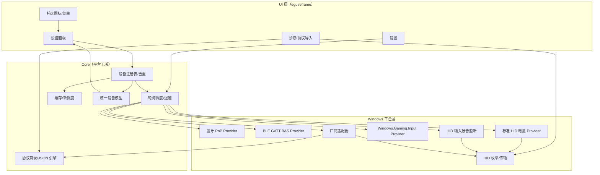

# AnyBattery 设计稿 v0.5

> Windows 10/11 x64 · Rust · 托盘常驻 · 只读 · 不装驱动 · 不要管理员权限
>
> 状态：**M1–M4 功能已实现，0.1.2 已发布**。当前版本为 0.1.2：像素风 UI、应用自绘标题栏、像素电池图标、五档电量配色、单 exe、主流协议族。
>
> v0.1 → v0.2：补齐雷蛇 / Steam Controller / Xbox / PlayStation / Nintendo / 8BitDo 及主流品牌协议族；确定 egui 自绘 UI；取消 CLI；明确由我交叉编译 release；轮询间隔改为用户可调范围。
>
> v0.2 → v0.3：发布形态改为**单个 exe**（资源内嵌、静态 CRT、无安装器）；协议族全量实现；未认证协议在 UI 明确标记。
>
> v0.3 → v0.4：UI 改为八位堂像素风（硬边框、零圆角、方块电量、Fusion Pixel 12px）；窗口改用 Windows 原生标题栏与按钮；按实际代码修正协议状态，移除未实现项的能力声明。
>
> v0.1.2：Razer 同步 HID 查询、90 字节以上报文适配、Viper 冲突 PID 识别与诊断增强；UI 标题、实色图标块、告警条、单行页脚与列表收缩。
>
> v0.4 → v0.5：按后续 UI 变更，标题栏改为应用自绘像素标题栏（最小化 / 最大化或还原 / 关闭到托盘），不再使用 Windows 原生 caption 按钮；新增同源像素电池应用图标；电量改为五档配色，充电保留档色。v0.3 → v0.4 的原生标题栏历史记录保留。

---

## 0. 你的决定（已写入设计）

1. **设备范围**：雷蛇、Steam Controller、Xbox 手柄等主流设备都要有。
2. **UI**：Rust 可以写好看；采用自绘 UI，不套 WebView。
3. **构建**：你有 Windows 但不想 build；**由我交叉编译并给 release**。
4. **交付形态**：只要托盘 + 面板（B），不做 CLI。
5. **范围**：接受“尽量广 + 未识别可诊断/可导入协议”，不承诺所有 dongle 开箱即用。
6. **默认值与许可**：中文界面（英文切换未实现）；开机自启默认关；低电量提醒 20%/10%；轮询可调；MIT/Apache-2.0。
7. **UI 风格**：八位堂像素风（暖色塑料底、2px 深色描边、零圆角、方块电量、Fusion Pixel 12px），跟随系统深浅色；窗口使用应用自绘像素标题栏与按钮（v0.5 后续变更，取代 v0.4 的 Windows 原生标题栏）。
8. **发布形态**：单个 exe；像素电池应用图标、Fusion Pixel 字体子集内嵌；exe/窗口/标题栏/托盘默认图标同源；当前无内置协议 JSON；静态 CRT；不依赖 WebView2/VC++ Redist/安装器。
9. **协议范围**：按协议族尽量覆盖；未认证/社区协议在 UI 明确标记，并严格校验报文形状；不承诺所有型号开箱即用。

无待确认项；以下为实现基线。

---

## 1. 一句话结论

做一个**轻量、只读、单 exe** 的 Windows 托盘工具：把系统已知的蓝牙电量、标准 HID 电量、手柄系统报告，以及主流厂商 2.4G 私有协议，统一成一张设备卡片；读不到就如实显示“未识别 / 休眠 / 上次电量”，并提供诊断与协议导入。

**“所有 2.4G/蓝牙设备”在技术上无法保证**：大量 dongle 使用私有、加密或带握手的协议，不装厂商驱动/不抓包无法通用读取。本项目的承诺是：

- 主流品牌按**协议族**覆盖，而不是只支持一两个型号；
- 未知设备**不猜电量**，给出可操作的诊断入口；
- 协议目录可持续扩展，用户可导入 JSON。

---

## 2. 覆盖范围

### 2.1 总览

| 类别 | 读取方式 | v1 状态 |
|---|---|---|
| 蓝牙经典耳机/音箱（HFP） | Windows PnP 电量属性 | ✅ |
| 蓝牙鼠标/键盘/手柄 | PnP 属性 | ✅ |
| BLE 标准外设 | PnP 属性；GATT `0x180F/0x2A19` 主动读取未实现 | 🟡 |
| Xbox 全系手柄 | Windows.Gaming.Input + XInput + PnP | ✅ |
| Steam Controller 2025/2026 | HID 输入报告 0x43（USB/BLE/Puck） | ✅ |
| Steam Controller 2015 | 旧状态消息 + 旧 dongle | ❌ 未实现 |
| PlayStation DualSense / DualShock 4 | HID 输入报告 | ✅ |
| Nintendo Switch Pro / Joy-Con | HID 输入报告 | ✅ |
| 8BitDo（部分型号，D-input / XInput） | HID 输入报告 | ✅ |
| 雷蛇鼠标/键盘/耳机 | 90 字节私有报文 | ✅ / 🟡 |
| 雷蛇耳机 PA 协议 | 64 字节 `P A` / `P I` 报文 | 🟡 |
| 罗技 HID++ 2.0 | Feature 报文，Unifying / Lightspeed / Bolt | ✅ |
| CompX 系（ATK/VXE/VGN/Pulsar/Hitscan/G-Wolves/WLmouse/Lamzu/MCHOSE） | 17B / 64B Output 报文 | ✅ 协议族覆盖 |
| VAXEE / ZYGEN、Endgame、Nordic | 特性/输出报文 | ✅ |
| Jieli / DARKRIM | 65B 0xFE 帧 + CRC16-CCITT | ❌ 未实现 |
| SteelSeries、HyperX、Corsair、ASUS ROG、Keychron、Lofree、NZXT | 各厂商报文 | 🟡 内置，严格校验 |
| 其他未知 2.4G dongle | 无法通用读取 | ❌ 显示未识别 + 诊断 |
| 加密/私有握手设备 | 不破解 | ❌ 显示未识别 |

> “✅”= 已内置并对报文头、长度、数值范围做校验；“🟡”= 协议来自公开资料/社区，未逐型号真机验证，只在回复形状完全匹配时显示电量；“❌”= 当前版本未实现。

### 2.2 为什么手柄反而更好做

- Xbox 手柄：Windows 自己提供 `Windows.Gaming.Input.RawGameController.TryGetBatteryReport()`，能拿到 mWh 和充电状态；XInput 还能给“低/中/满”的粗粒度兜底。
- PlayStation / Nintendo / 8BitDo / Steam：手柄会在 HID 输入报告中**主动上报**电量，不需要发命令，属于纯被动监听，风险最低。
- 2.4G 鼠标/键盘/耳机才是难点：多数需要发厂商私有请求，部分还会休眠、被厂商软件占用。

---

## 3. 总体架构



### 3.1 分层

- **core**：设备模型、状态机、去重、调度、缓存、协议 JSON 解析。可在 Linux 单测。
- **windows**：SetupAPI/CfgMgr32/HID/WinRT，所有 `unsafe` 集中在这里。
- **adapters**：厂商协议族（Razer、Logitech、CompX、SteelSeries…）。
- **app**：egui 面板、托盘、设置、诊断、通知、自启。

### 3.2 线程/事件

- `DeviceService` actor 独占设备状态；命令通道 + 快照通道。
- 2–4 个 worker 执行阻塞 HID/属性读取；同一物理设备串行。
- WinRT 异步调用放专用线程，外层超时监督；超时取消，不无限等待。
- 托盘消息窗口接收 `WM_DEVICECHANGE` / `WM_POWERBROADCAST`，防抖 2 秒后重扫。
- UI 只读快照；收到新快照时 `request_repaint()`。

---

## 4. 设备模型与状态

```rust
pub struct DeviceSnapshot {
    pub id: DeviceId,                 // 稳定 ID
    pub name: String,
    pub kind: DeviceKind,             // Mouse/Keyboard/Headset/Controller/Pen/Unknown
    pub transport: Transport,         // BluetoothClassic/BluetoothLe/Usb24g/Usb/Unknown
    pub battery: BatteryReading,
    pub status: BatteryStatus,
    pub source: BatterySource,        // 具体 provider/adapter
    pub confidence: Confidence,       // Verified/Community/OsReported/Coarse/Cached
    pub last_seen: Option<SystemTime>,
    pub updated_at: Option<SystemTime>,
    pub detail: String,
}

pub enum BatteryReading {
    Percent { level: u8, charging: Option<bool> }, // 0-100，真实百分比
    Coarse { level: CoarseLevel },                 // 低/中/满（XInput 兜底）
    Unknown,
}

pub enum BatteryStatus {
    Available, Charging, Full, Asleep, Stale,
    Unsupported, Error, Unknown,
}
```

### 4.1 UI 文案

| 状态 | 卡片 | 说明 |
|---|---|---|
| Available | `62%` + `刚刚` | 本次读取成功 |
| Charging | `62%` + `充电中` | 设备上报充电 |
| Full | `100%` + `已充满` | 设备上报满电 |
| Asleep | `上次 62%` + `2 小时前 · 设备休眠` | 有缓存，本次无回复 |
| Stale | `上次 62%` + `昨天 · 可能不准确` | 超过新鲜期（默认 24h） |
| Coarse | `电量中` + 三段电池图标 | 只有低/中/满，不伪造百分比 |
| Unsupported | `已连接 · 未找到电量协议` | 设备存在但读不到 |
| Error | `读取失败` + `查看原因` | 权限/占用/超时 |

**原则：宁可显示“不知道”，也不显示猜出来的百分比。**

---

## 5. Provider 设计

### 5.1 合并策略

按设备类型选择主路径，而不是全局一条优先级：

- **蓝牙耳机/音箱**：PnP 属性 → 缓存。
- **蓝牙鼠标/键盘/手柄**：PnP 属性 → BLE GATT → 缓存。
- **Xbox 手柄**：Windows.Gaming.Input → XInput 粗粒度 → PnP/BLE → 缓存。
- **PlayStation/Nintendo/8BitDo/Steam**：HID 输入监听（被动）→ 缓存。
- **2.4G 鼠标/键盘/耳机**：厂商适配器 → 标准 HID → 缓存。
- **未知 HID**：标准 HID → 诊断页，不猜。

同一设备多候选时：Verified adapter > OS controller report > Standard HID > PnP > BLE GATT > Cache。诊断页保留全部候选。

### 5.2 蓝牙 PnP（被动）

- 枚举 `BTHENUM` / `BTHLE` present devnode。
- 读取 FriendlyName、IsConnected、电量属性 `{104EA319-6EE2-4701-BD47-8DDBF425BBE5},2`，如可用再读时间戳 `...,7`。
- 只接受 0–100；0 视为未上报，不显示 0%。
- 按蓝牙地址归并；名称去掉 `Hands-Free AG`、`Avrcp Transport`、`Stereo` 等后缀。
- 不主动配对、不修改连接状态。

### 5.3 BLE GATT BAS（主动，兜底，v1 未实现）

- 设计：只对已配对/已连接设备；`0x180F` → `0x2A19` → `ReadValueAsync`；3 秒超时；同一设备 10 分钟内不重复主动连接。
- 当前版本只读取 Windows PnP 电量属性，**没有主动连接 GATT**；设置页中的“主动读取 BLE 电量”开关已移除，避免无效选项。
- 后续接入时保持只读，不写 characteristic，并默认只在 PnP 缺失时尝试。

### 5.4 标准 HID 电量（被动/只读）

- 枚举 `GUID_DEVINTERFACE_HID`，读 `HidD_GetAttributes`、`HidP_GetCaps`、Product String。
- `HidP_GetValueCaps` 按以下顺序找百分比：
  - `0x0085/0x0064` Relative State of Charge
  - `0x0085/0x0065` Absolute State of Charge
  - `0x0006/0x0020` Battery Strength
  - `0x000D/0x003B` 触控笔 Battery Strength
- `0x0085/0x0066` 是 RemainingCapacity，不是百分比 usage；当前不把它作为百分比候选，避免没有单位/容量换算时误报。
- **不把 `0x0006/0x0029` RF Signal Strength 当电量，也不把 `0x0085/0x0001` 当 Absolute State of Charge。**
- 同一 collection 的 `0x0085/0x0044` Charging、`0x0085/0x0045` Discharging 用于充电状态；两者冲突或缺失时保持未知。
- Feature Report 读回后用 `HidP_GetUsageValue` 取值，按 LogicalMin/Max 缩放；兼容 report id 0 的两种缓冲布局。
- Input Report 电量字段：监听 2–3 秒；提示“动一下设备”。

### 5.5 Windows.Gaming.Input（Xbox 系）

- 枚举 `RawGameController.RawGameControllers`。
- `TryGetBatteryReport()`：
  - `RemainingCapacityInMilliwattHours` / `FullChargeCapacityInMilliwattHours` → 百分比；
  - `Status` → 充电/放电/满/未连接。
  - 若 Full 为 0 或数据缺失 → 回退。
- 回退 `XInputGetBatteryInformation`：只给 `EMPTY/LOW/MEDIUM/FULL`，显示为粗粒度，不换算成假百分比。
- 蓝牙 Xbox：XInput 电量接口在蓝牙下常失效，改走 PnP/BLE；RawGameController 若可用则优先。
- 支持 Xbox Wireless Adapter、USB、蓝牙三种连接。

### 5.6 HID 输入监听（手柄/耳机）

对会在输入报告中主动上报电量的设备，打开句柄后监听，不发任何写命令：

| 设备 | 报告 | 电量 | 充电 |
|---|---|---|---|
| Steam Controller 2025/2026 | Input `0x43` | byte 2（%） | byte 1：1 放电 / 2 或 4 充电 |
| Steam Controller 2015 | 状态消息（message id 4） | 未实现 | 未实现 |
| DualSense | USB byte 53 / BT full byte 54 | 0–10 → ×10 | 状态位 |
| DualShock 4 | USB byte 30 / BT full byte 32 | 0–10 → ×10 | 状态位 |
| Switch Pro / Joy-Con | 输入报告 byte 2 | 0–8，步进 2 → 0/25/50/75/100 | 充电位 |
| 8BitDo Pro 3 | 输入报告 byte 14 | bit 0–6（%） | bit 7 |
| 8BitDo 其他 D-input | 增强输入报告 byte 14 | bit 0–6（%） | bit 7 |

- 监听窗口：Steam 5 秒（约 2.5 秒一帧）；其他 3–4 秒。
- 只保留最后一帧用于诊断；不持续占用句柄。
- 不改变手柄模式、不发 rumble/IMU/lizard 命令。

### 5.7 厂商适配器

#### 雷蛇（Razer）

- **鼠标/键盘 90 字节 Feature Report**：
  - 写 90 字节（报告 id 0，部分接口 91 字节），命令类 `0x07`，命令 `0x80` 读电量、`0x84` 读充电。
  - 回复 status byte 0；电量 byte 9，原始 0–255 → `raw * 100 / 255`。
  - transaction id 因型号/连接而异：鼠标常用 `0x1F`，无线键盘 `0x9F`，有线 `0x3F`，部分 `0xFF`；适配器按候选列表尝试，并记住成功值。
  - 接口/collection 不固定：优先 `0xFF00` 厂商页，失败后遍历可写接口。
- **雷蛇耳机 PA 协议**：
  - 64 字节 vendor 帧，`P A` 发出，`P I` 回复；电量命令 `0x21`，充电 `0x2A`。
  - 适用 Barracuda Pro、BlackShark V2 Pro 2023 等；与鼠标协议不同，按 PID/产品字符串路由。
- **BlackShark V2 Pro 2020**：当前走 90 字节 PID 0x0528 路径；专用 `FF 0A ...` 帧未实现。
- 与 Synapse 共存：共享打开、短句柄、失败重试；不结束 Synapse。

#### 罗技（Logitech）

- HID++ 2.0：Feature `0x1004` 统一电池、`0x1000` 电池状态、`0x1001` 电压、`0x1F20` ADC。
- 接收器设备索引 1–6，直连设备用 `0xFF`；支持 Unifying / Lightspeed / Bolt；短（0x10）和长（0x11）报文都试。
- 电压型设备用锂电曲线换算百分比；曲线不适用时跳过，不显示猜测值。

#### CompX 系（国产 2.4G 主力）

- **17 字节 Output**：report id `0x08`，命令 `0x04`，电量 byte 6，充电 byte 7，毫伏 byte 8–9，checksum byte 16 = `0x55 - sum(first 16)`。
- **64 字节 Output**：report id `0x08` + `7D 72 02 00 01 07 01`；回复 `[1]=0x72,[5]=0x07`；电量 byte 7。
- **0x83 特性报文族**：设计中的 `00 00 02 02 00 83` 帧尚未实现；当前 CompX 只走 17B / 64B 两条路径。
- **MCHOSE 变体**：`55 05 00 38 38 00` / `4A` / `87` 等，按型号表。
- 设备休眠时重试 2–3 次；仍无回复则保留上次值并标灰。

#### 其他协议族

| 协议族 | 匹配 | 方式 | 取值 | 状态 |
|---|---|---|---|---|
| VAXEE / ZYGEN | VID 3057, usage FF05 | Feature 0x0E + A5 0B 01 01 | byte 5，5% 步进 | ✅ |
| Endgame Gear | VID 3367, usage FF01 | Feature 0xA1 + B4 | byte 16；电压 17–18 | ✅ |
| Nordic nRF | VID 1915, usage FFA0 | Feature 0x05 + 15 00 00 01 | byte 9 | ✅ |
| Jieli / DARKRIM | VID 3654, usage FF02 | 65B 0xFE 帧 + CRC16-CCITT | TLV 0x01 | ❌ 未实现 |
| SteelSeries | 1038 系 | 0xB0 / 0xAA 请求 | 按型号，九步/百分比 | 🟡 |
| HyperX | 03F0 系 | 0x66 / 0x50 / 0x0C 帧 | 按型号 | 🟡 |
| Corsair | 1B1C 系 | Slipstream 0x02 帧 | 0x0F 电量、0x10 充电 | 🟡 |
| ASUS ROG | 0B05 系 | Output 0 + 12 07 | byte 5；充电 byte 10 | 🟡 |
| Keychron | 3434 系 | Feature B3 06 → B4 06 | byte 20 | 🟡 |
| Lofree | 388D:0025 | Report 0x04，1A 命令 | byte 7 | 🟡 |
| NZXT | 1E71 系 | 4E 02 81 00 B0 | bytes 17–18 LE | 🟡 |
| Razer PA 耳机 | 1532 系 | P A / P I | 0x21 电量 | 🟡 |

> 🟡 协议族会内置，但只在回复长度、头部、范围全部匹配时显示；否则显示“未识别”，不猜。每个适配器带 `verification: verified | community | unverified`，诊断页可见。

### 5.8 JSON 协议引擎（core 已实现，尚未接入 UI）

适合“固定请求 → 固定回复 → 固定偏移”的协议；复杂帧（CRC/TLV/序号）用 Rust adapter。

当前状态：`anybattery-core` 已有 schema 解析、字段校验和单测；扫描器与设置页还没有调用它，因此 0.1.2 release **不支持**自定义 JSON 协议导入。下面是接入时使用的格式。

```json
{
  "schema": 1,
  "id": "example.atk64",
  "name": "ATK/VXE 64-byte",
  "match": { "vid": "373B", "pid": null, "usage_page": "FF05", "min_output_len": 64 },
  "request": { "kind": "output", "report_id": 8, "length": 64, "payload_hex": "7D720200010701" },
  "response": { "kind": "input", "timeout_ms": 600, "retries": 3, "match": [[1, "72"], [5, "07"]] },
  "extract": {
    "level": { "offset": 7, "type": "u8", "scale": 1.0, "min": 0, "max": 100 },
    "charging": null
  },
  "verification": "verified",
  "notes": "电量在回复第 7 字节"
}
```

- 支持 `request.kind`: `output` | `feature_set` | `none`（纯监听）。
- 支持 `response.kind`: `input` | `feature_get`。
- 校验：长度上限、偏移边界、超时 ≤ 5s、重试 ≤ 5、scale 范围、level 0–100。
- 接入后：导入时先“试读一次”，成功才保存；失败给出原因。
- 接入后：用户协议目录为 `%APPDATA%\AnyBattery\protocols\*.json`；便携模式为 `data\protocols`。
- 当前没有内置协议 JSON；接入后可用 `include_str!` 嵌入，同 ID 用户协议可覆盖。

---

## 6. 设备身份与去重

### 6.1 蓝牙

- 从 `BTHENUM\Dev_XXXXXXXXXXXX\...` / `BTHLE\Dev_XXXXXXXXXXXX\...` 提取地址。
- 稳定 ID：`bt:<12-hex>`。
- 同地址多节点合并，优先有值且新鲜的候选。
- 名称清洗后为空则用设备描述/地址尾号。

### 6.2 2.4G HID

- `DEVPKEY_Device_ContainerId` 归并同一接收器的多个 HID 接口。
- 稳定 ID：`hid:<container-guid>:<adapter-id>:<device-index>`。
- 罗技 Unifying/Lightspeed：一个接收器多个设备，适配器返回多个快照，副标题“设备 1/2”。
- 无 ContainerId 时按路径去掉 `&MI_xx` / `&Colxx` 分组。
- 同 VID/PID 的两台设备：ContainerId → 序列号 → 路径哈希。

### 6.3 手柄

- Xbox：XInput 设备、RawGameController、PnP 可能同时出现；按 ContainerId / 设备路径 / 名称归并。
- Steam Puck：一个 puck 最多 4 个 slot，每个 slot 独立设备，ID `steam:<puck-path>:<slot>`；slot 断开立即移除。
- PlayStation/Nintendo/8BitDo：按 HID 路径 + 序列号；有线/无线同一型号优先保留正在使用的那条。
- 雷蛇/罗技接收器与有线线缆：同一型号共享一个图标，充电中的读数优先。

### 6.4 名称

- 优先级：HID Product String → PnP FriendlyName → 适配器名称 → VID/PID。
- 支持用户重命名（按稳定 ID 保存）。

---

## 7. 轮询、缓存与生命周期

- **默认 60 秒**；UI 可调 **15 秒 – 30 分钟**（滑块 + 预设 15/30/60/120/300/600/1800 秒）。
- 每设备独立 `next_due`，加 0–5 秒抖动。
- 失败退避：60s → 2min → 4min → 8min（上限 10min）；成功复位。
- 手动刷新立即执行，不受退避限制。
- 手柄监听类：Steam 5 秒窗口；其他 3–4 秒；无数据不重复轰炸。
- BLE 主动读取：同一设备 10 分钟限流；可关闭。
- 热插拔：`WM_DEVICECHANGE` 防抖 2 秒重扫。
- 睡眠唤醒：`WM_POWERBROADCAST` 后延迟 3 秒刷新，复位退避。
- 缓存：内存 + `%APPDATA%\AnyBattery\state.json` 原子写入；保存电量/充电/时间/来源，不保存原始报文（诊断模式除外）。
- 启动先显示缓存（灰色），随后异步刷新。
- 低电量通知：20% 和 10%，每个放电周期只通知一次；充电后复位。
- 单实例：命名 mutex；第二次启动唤起已有窗口。
- 托盘 tooltip：设备数 + 最低电量设备。

---

## 8. UI / UX

### 8.1 视觉方向：八位堂像素风

不是复刻 macOS，而是一套“像素游戏机 UI”的自绘设计系统：

- **背景**：暖米色 `#E8E2D4`，顶部略亮的 `#F4EFE4`；深色模式 `#23211D`。窗口外框与应用标题栏也由自绘像素系统提供；标题栏 40px、浅底/深色主题、2px 底部分隔线，右侧为最小化 / 最大化或还原 / 关闭按钮。
- **卡片**：实色 `#F7F2E7`，2px 深墨色 `#2E2B26` 描边，零圆角，右下 2px 硬阴影；深色模式 `#322F29`。
- **主色**：八位堂红 `#C8443C`；绿 `#4F8A5B`；橙 `#D98A2B`；深红 `#8E2F29`；黄 `#E6BE50`。
- **文字**：主 `#2B2823`，次 `#6F6A5E`，弱 `#9A9486`；深色模式主 `#F3EEDF`。正文 12px，标题 24px，标题用同字体加粗。
- **电量**：五档：0–10 红、11–20 橙、21–50 黄/赭黄、51–80 黄绿/橄榄、81–100 绿；卡片电量格与动态托盘共用同一映射，充电保留档色并用符号表达。粗粒度只显示 3 格 + “低/中/满”，不伪造档色。
- **图标**：16/32px 像素图标，2px 描边，零圆角；exe、窗口、标题栏与托盘默认图标同源，静态品牌图标固定色；动态托盘按最低电量使用五档色。不使用 SF Symbols。
- **动效**：80ms 控件过渡，不做玻璃模糊、不做呼吸光晕；设置可关。
- **字体**：内置 Fusion Pixel 12px（OFL），覆盖 GB2312；生僻字回退系统 `Microsoft YaHei UI`。
- **布局**：40px 自绘像素标题栏（电池图标 + AnyBattery + 最小化/最大化/关闭）→ 顶部工具栏（刷新/设置）→ 大标题 + 分段控件（全部/蓝牙/2.4G/手柄）→ 设备列表 → 底部刷新状态与诊断入口。

> 说明：像素风依赖硬边框、有限色板和整数像素对齐；在 125%/150% DPI 下会按 egui 的缩放绘制，不追求逐像素锐利。

### 8.2 面板布局

下面只画内容区；40px 自绘像素标题栏在内容区上方，由应用绘制，实际窗口不显示 Windows 原生 caption 按钮。

```
┌──────────────────────────────────────┐
│  电池                           ⟳  ⚙  │
│  4 台设备 · 2.4G 2 · 蓝牙 1 · 手柄 1 │
│  ┌────────┬────────┬────────┬──────┐ │
│  │  全部  │  蓝牙  │  2.4G  │ 手柄 │ │
│  └────────┴────────┴────────┴──────┘ │
│  ╭────────────────────────────────╮  │
│  │ 🖱  雷蛇 炼狱蝰蛇 V3 Pro        │  │
│  │     2.4G · 刚刚 · 已验证        │  │
│  │                    ▮▮▮▮▮▮░░ 62% │  │
│  ╰────────────────────────────────╯  │
│  ╭────────────────────────────────╮  │
│  │ 🎮  Steam Controller            │  │
│  │     2.4G Puck · 充电中          │  │
│  │                    ▮▮▮▮▮▮▮▮ 85% │  │
│  ╰────────────────────────────────╯  │
│  ╭────────────────────────────────╮  │
│  │ 🎮  Xbox Wireless Controller    │  │
│  │     蓝牙 · 1 分钟前 · 系统报告  │  │
│  │                    ▮▮▮▮░░░░ 40% │  │
│  ╰────────────────────────────────╯  │
│  ╭────────────────────────────────╮  │
│  │ 🎧  Sony WH-1000XM5             │  │
│  │     蓝牙 · 充电中               │  │
│  │                    ▮▮▮░░░░░ 35% │  │
│  ╰────────────────────────────────╯  │
│  刷新 60 秒 · 12:31         [诊断]   │
└──────────────────────────────────────┘
```

- 排序：低电量优先，其次最近更新；同电量按名称。
- 分组：2.4G / 蓝牙 / 手柄 / 未识别（可折叠）。
- 卡片悬浮：来源、原始值、设备路径、错误详情。
- 未识别卡片：`已连接 · 未找到电量协议` + `[帮助适配]`。
- 空状态：`未发现可读取电量的设备` + `插入设备，或打开诊断查看已识别设备`。
- 粗粒度：显示三段电池 + “低/中/满”，不显示百分比。

### 8.3 托盘

- 左键：显示/隐藏面板。
- 右键：刷新、设置、诊断、开机自启（勾选）、退出。
- Tooltip：`4 台设备 · 鼠标 18%`。
- 图标：默认使用与 exe、窗口、标题栏同源的像素电池图标；动态托盘按最低电量使用与卡片相同的五档色。v1.1 可选“每设备一个托盘图标”。
- 低电量托盘颜色随五档变化；10%/20% 提醒阈值不变，充电保留档色。

### 8.4 设置

- **刷新间隔**：15 秒 – 30 分钟，滑块 + 预设；默认 60 秒。
- 开机自启（HKCU Run；默认关）。
- 低电量提醒（开/关；面板顶部横幅 + 托盘图标变色；阈值 20%/10% 固定）。
- 显示无电池设备（默认关；打开后列出未匹配协议的设备）。
- 主题：跟随系统 / 浅色 / 深色。
- 动画（开/关）。
- 打开配置目录 / 恢复默认。
- 便携模式：exe 同目录 `portable.txt` → 配置写 `data\`。
- 语言切换、清空缓存、系统 Toast 尚未实现。

### 8.5 诊断（面板内标签页，不单独做 CLI）

- 刷新、复制诊断信息、打开配置目录。
- 诊断日志：扫描结果、HID 接口路径 / VID / PID / Usage / 长度、每个设备的识别路径与未识别原因；随扫描更新。
- 尚未实现：选中接口读 Feature、监听 Input、十六进制发送、协议导入/导出、文件日志。
- 日志目前只保存在内存，不写磁盘。

---

## 9. 技术栈与代码结构

### 9.1 UI：egui/eframe（自绘）

| 选项 | 结论 |
|---|---|
| **egui/eframe + tray-icon** | **选它**：单 exe、无 WebView、内存低、交叉编译相对可控、MIT/Apache；自绘八位堂像素风 |
| Tauri 2 + React | 备选：更接近 Web 的精致感，但 WebView2 依赖、体积大、Linux 交叉编译更麻烦 |
| Slint | 不选：许可与生态不适合 |
| 纯 Win32/Direct2D | 不选：工作量太大 |

### 9.2 目录

```text
AnyBattery/
├─ Cargo.toml                 # workspace
├─ crates/
│  ├─ anybattery-core/        # 模型/设置/去重/JSON 协议解析
│  ├─ anybattery-windows/     # SetupAPI/CfgMgr32/HID/蓝牙 PnP/Xbox/厂商适配
│  └─ anybattery-app/         # egui + tray + settings + diagnostics
├─ docs/
│  ├─ ui-mockup-pixel.svg
│  └─ ui-mockup-pixel.png
└─ release/                   # 本地打包产物（gitignore）
```

### 9.3 依赖方向

- `windows`：Win32 HID/SetupAPI/CfgMgr32/Shell/Registry + WinRT Bluetooth/Gaming.Input/Power。
- `egui` / `eframe`：面板与设置。
- `tray-icon`：托盘。
- `serde` / `serde_json`：配置与协议。
- `thiserror` / `anyhow`：错误。
- `tracing` / `tracing-subscriber`：日志。
- `parking_lot` / `crossbeam-channel`：并发。
- `single-instance`：单实例。
- `directories`：配置路径。
- `egui-phosphor`：图标。
- `ab_glyph` + `tiny-skia`：动态托盘图标（可选）。

### 9.4 Windows API 要点

- HID：`SetupDiGetClassDevsW(GUID_DEVINTERFACE_HID)` → `SetupDiEnumDeviceInterfaces` → `SetupDiGetDeviceInterfaceDetailW`。
- 打开：`CreateFileW(..., FILE_SHARE_READ|FILE_SHARE_WRITE, OPEN_EXISTING, FILE_FLAG_OVERLAPPED)`；失败降级 0 权限只读。
- 能力：`HidD_GetPreparsedData` + `HidP_GetCaps` + `HidP_GetValueCaps`。
- Feature：`HidD_GetFeature` / `HidD_SetFeature`；Output：`WriteFile`；Input：`ReadFile` + 超时。
- 设备属性：`CM_Get_Device_ID_ListW` + `CM_Locate_DevNodeW` + `CM_Get_DevNode_PropertyW`。
- 蓝牙：WinRT `BluetoothLEDevice` / `GattDeviceService` / `GattCharacteristic`。
- 手柄：WinRT `RawGameController` / `IGameControllerBatteryInfo` / `BatteryReport`；XInput 兜底。
- 通知：隐藏消息窗口 `WM_DEVICECHANGE` / `WM_POWERBROADCAST`。

### 9.5 超时与并发

- 单设备读取预算 1.5 秒（Steam 监听 5 秒例外）；超时标记 Error 并退避。
- 同一设备同一时间一个句柄；读完立即关闭。
- 不强制终止线程；卡住设备隔离，后续跳过。

---

## 10. 安全、隐私与兼容性

- 不装驱动、不注册服务、不写系统目录、不要管理员权限。
- 只读：默认只发已知适配器的查询报文；诊断页任意发送需二次确认且不保存。
- 不联网：v1 无网络请求、无遥测、无崩溃上传。
- 不注入：不读写其他进程内存、不 Hook、不加载 DLL 到游戏；对反作弊友好。
- 日志：默认内存；`--debug` 文件滚动上限 5MB；不记录用户输入/文件名。
- 配置：`%APPDATA%\AnyBattery\`；便携模式可改。
- 厂商软件共存：共享打开；被独占时提示“关闭厂商软件后可重试”，不强行结束进程。
- SmartScreen：未签名 exe 会提示；release 说明中写明，后续可选签名。
- 许可：本项目 MIT/Apache-2.0；参考项目只取协议事实，不复制 GPL 代码。

---

## 11. 构建、测试与发布

### 11.1 由我构建 release（你不需要装 Rust）

- 我的环境是 Linux；目标 Windows x64。
- 方案：
  1. 安装 Rust stable（用户级 `~/.cargo`，不需要 sudo）。
  2. 安装 LLVM/clang/lld（用户级 tarball，提供 `clang-cl`/`lld-link`/`llvm-lib`/`llvm-rc`）。
  3. `cargo install cargo-xwin`，用 MSVC 目标 `x86_64-pc-windows-msvc` 交叉编译。
  4. 若交叉编译遇到平台限制，用 GitHub Actions `windows-latest` 作为后备；仍然由我产出 artifact，你只下载。
- **M0 先做工具链 spike**：编译一个最小 egui + tray 的 Windows exe，确认能产出可运行的 release，再进入 M1。避免“写到一半发现打不出包”。
- 我无法在 Linux 上真机验证 Windows HID/蓝牙；需要你在 Windows 上双击测试，并把诊断页导出的信息发我。硬件相关适配会按“先严格校验、再逐步放开”的方式迭代。

### 11.2 发布物

- **单个 `AnyBattery.exe`**：图标、Fusion Pixel 12px 字体子集通过 `include_bytes!` 内嵌；当前没有内置协议 JSON。
- 使用 `+crt-static` 静态链接 CRT，不要求 VC++ Redistributable；不依赖 WebView2。
- 便携优先；配置写 `%APPDATA%\AnyBattery\`，exe 同目录有 `portable.txt` 时写 `data\`。
- 每个 release 附 SHA-256、发布说明与已知限制；zip 仅用于下载，解压后仍只有一个 exe。
- 不默认自动更新。

### 11.3 测试分层

- **core 单测（Linux 可跑，当前 12 项）**：实例 ID 解析、名称清洗、去重、协议 JSON 校验、缩放、阈值顺序、粗粒度语义。
- **fixture 测试**：真报文十六进制 → 解析结果尚未补齐；当前协议适配器只做编译与运行时形状校验。
- **Windows 集成测试（CI/手动）**：HID 枚举、PnP 属性、RawGameController 枚举、CM 设备列表。
- **真机矩阵（需要你）**：
  - Xbox 手柄：蓝牙 / USB / Xbox Wireless Adapter
  - Steam Controller：Puck / USB / BLE（2025 款）
  - DualSense / DS4 / Switch Pro / 8BitDo
  - 雷蛇鼠标/键盘/耳机（至少各一）
  - 罗技 Unifying/Lightspeed
  - ATK/VXE/VGN/Pulsar 等 CompX
  - 未知 dongle
  - 设备休眠/唤醒、厂商软件同时运行、两个同型号设备、热插拔 20 次、睡眠唤醒 10 次、24h soak

### 11.4 质量目标

- 冷启动到托盘 < 1.5 秒；空闲 CPU < 0.1%；内存 < 60 MB。
- 单设备读取通常 < 1 秒；最坏 1.5 秒（Steam 监听 5 秒除外）。
- 无管理员权限、无驱动安装、无崩溃（24h soak）。

---

## 12. 里程碑

| 阶段 | 内容 | 状态 |
|---|---|---|
| **M0 设计确认 + 工具链** | 本稿确认；Rust/LLVM/cargo-xwin 安装；最小 tray exe 交叉编译成功 | ✅ 完成 |
| **M1 核心 + 托盘** | workspace、HID 枚举、BT PnP、标准 HID、缓存、egui 面板、托盘、设置、轮询 | ✅ 代码完成，待真机验收 |
| **M2 手柄 + 雷蛇** | Xbox/Steam 2025/PS/Nintendo/8BitDo；Razer 90B + PA；诊断页 | ✅ 代码完成，待真机验收 |
| **M3 主流协议族** | Logitech/CompX/SteelSeries/HyperX/Corsair/ASUS/Keychron/Lofree/NZXT/VAXEE/Endgame/Nordic | 🟡 代码完成；Jieli、JSON 导入未实现 |
| **M4 打磨 + 发布** | 自绘像素标题栏、像素电池图标、五档配色、托盘动态图标、zip、文档、SHA-256 | ✅ 0.1.2 已发布（Razer 同步 HID 查询与诊断增强）；Toast、单实例、代码签名未做，24h soak 待做 |

每个里程碑结束都停下来给你验收，不一次性写完再给你。

---

## 13. 主要风险与对策

| 风险 | 影响 | 对策 |
|---|---|---|
| 型号太多，协议差异大 | 覆盖不全 | 按协议族实现 + 严格校验 + 诊断/导入；持续补型号表 |
| 社区协议未验证 | 显示错误电量 | 只在回复形状完全匹配时显示；标记 community/unverified；范围校验 |
| 厂商软件独占 HID | 读取失败 | 共享打开、短句柄、重试、提示关闭厂商软件 |
| 设备休眠 | 读不到 | 缓存 + 休眠文案；提示动一下；退避 |
| BLE 主动连接干扰（未来接入时） | 设备卡顿/耗电 | PnP 优先、10 分钟限流、可关闭 |
| 一个接收器多设备 | 重复/混淆 | ContainerId + 设备索引 + 副标题 |
| 蓝牙多 devnode | 重复显示 | 地址归并 + 名称清洗 |
| Xbox 蓝牙电量 API 缺失 | 读不到 | RawGameController → PnP/BLE → XInput 粗粒度 |
| 交叉编译失败 | 无法交付 release | M0 spike；GitHub Actions 后备 |
| 像素字体在 125%/150% DPI 下不够锐利 | 观感下降 | 整数像素对齐 + 2px 描边 + 高对比配色；必要时提供 2x 字体 |
| 未签名 exe | SmartScreen | 文档说明；后续可选签名 |

---

## 14. 已确认的决定

1. **UI 风格**：八位堂像素风；应用自绘像素标题栏与窗口按钮；exe/窗口/标题栏/托盘默认图标同源；五档电量配色；跟随系统深浅色；10%/20% 提醒阈值不变。
2. **release 形态**：单个 exe，资源内嵌、静态 CRT。
3. **协议范围**：按协议族尽量覆盖；未认证协议标记 `community/unverified`；不承诺所有型号开箱即用。
4. **轮询**：默认 60 秒，用户可在 15 秒–30 分钟之间调整。
5. **交付方式**：由我交叉编译 release，你只需下载运行并反馈诊断信息。
6. **显示策略**：默认只显示有电量的设备；无电池 / 未匹配协议的设备可在设置中打开显示。
7. **窗口行为**：最小化、最大化或还原、关闭到托盘；退出走托盘右键菜单。

---

## 15. 参考与许可

协议事实与实现思路参考：

- **HaloBattery**（MIT）：`docs/protocols.md`，覆盖雷蛇、Steam Controller、Xbox、PlayStation、Nintendo、8BitDo、罗技、CompX、SteelSeries、HyperX、Corsair、ASUS、Keychron、Lofree、NZXT 等。
- **SDL3**（zlib）：Steam Controller Triton / 旧版 Steam Controller HID 解析。
- **Linux hid-steam**（GPL-2.0）：旧版 Steam Controller 电池事件布局（仅协议事实）。
- **OpenRazer**（GPL-2.0）：雷蛇 90 字节报文与型号表（仅协议事实）。
- **HeadsetControl**（MIT）：部分耳机协议。
- 参考仓库：`yszyszysz233/2.4G-battery-viewer`、`2217Luv/AirVolt`、`Ferris-echo/FerrisPulse`（GPLv3）、`Ap0LoG1zE/EZ2.4G`。
- Microsoft Learn：`RawGameController.TryGetBatteryReport`、`IGameControllerBatteryInfo`、`XInputGetBatteryInformation`、HID/SetupAPI/CfgMgr32 文档。

实现采用**净室重写**：只使用协议常量、报文格式、系统 API 用法等事实性信息；不复制 GPL 代码、注释、UI 资源或文案。若引入第三方代码，单独记录来源与许可证。

---

## 16. 附：v1 不做的“看起来能但实际不可靠”的事

- 不根据“某个字节可能是 0–100”去猜未知协议并展示。
- 不把 RF 信号强度当电量。
- 不把 XInput 的低/中/满换算成 25/50/100%。
- 不对休眠设备反复轰炸。
- 不主动配对未配对的蓝牙设备。
- 不静默安装驱动/服务。
- 不强行结束厂商软件来抢 HID 句柄。
