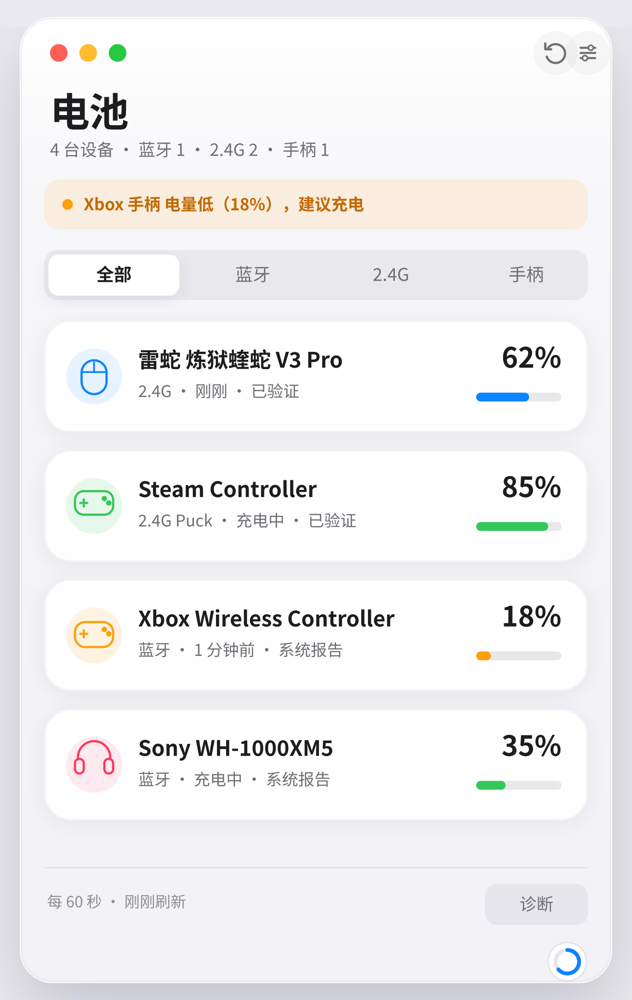

# AnyBattery

Windows 10/11 的 2.4G / 蓝牙设备电量托盘工具。Rust 编写，单 exe，只读，不装驱动，不需要管理员权限。



## 下载

前往 [Releases](../../releases) 下载最新 `AnyBattery-*-win64.zip`，解压后直接运行 `AnyBattery.exe`。

- 单文件，无安装器
- 静态 CRT，不依赖 WebView2 / VC++ Redistributable
- 内置中文字体
- 未签名，SmartScreen 可能提示“未知发布者”

## 当前能力

| 类别 | 方式 | 状态 |
|---|---|---|
| 蓝牙经典 / BLE 设备 | Windows PnP 电量属性（BTHENUM / BTHLE） | ✅ |
| 标准 HID 电量 | Battery Strength / State of Charge 等 usage | ✅ |
| Xbox 系手柄 | `Windows.Gaming.Input.RawGameController` 电池报告 | ✅ |
| 雷蛇鼠标 / 键盘 | 90 字节 Feature 报文，OpenRazer 型号表 | ✅ |
| CompX 系（Pulsar / ATK / VXE / Hitscan） | 17 字节 / 64 字节 Output 报文 | ✅ |
| VAXEE / ZYGEN | Feature 报文 | ✅ |
| Endgame Gear | Feature 报文 | ✅ |
| Nordic nRF | Feature 报文 | ✅ |

尚未实现：罗技 HID++、Steam Controller、PlayStation、Switch、8BitDo、雷蛇耳机 PA、SteelSeries / HyperX / Corsair / ASUS / Keychron 等协议族，BLE GATT 主动读取，系统 Toast 通知。未识别设备会如实显示“未找到电量协议”，不会猜测百分比。

## 功能

- 托盘常驻，左键面板，右键菜单
- 深色 / 浅色 / 跟随系统，Apple 风格自绘界面
- 电量环、充电状态、上次更新时间、数据来源与“已验证 / 社区协议 / 未验证”标记
- 设备休眠时保留上次值并标灰
- 刷新间隔 15 秒 – 30 分钟可调，默认 60 秒
- 低电量横幅与托盘图标变色
- 诊断页：HID 接口、usage、报文来源、复制诊断信息
- 开机自启（HKCU Run，默认关闭）
- 当前允许多开，单实例限制会在后续版本加入
- 无网络请求、无遥测、不注入进程

## 构建

需要 Rust stable 与 Windows MSVC 目标。Linux 交叉编译可使用 `cargo-xwin` + LLVM：

```bash
rustup target add x86_64-pc-windows-msvc
cargo install cargo-xwin --locked
cargo xwin build -p anybattery-app --target x86_64-pc-windows-msvc --release
```

产物：`target/x86_64-pc-windows-msvc/release/AnyBattery.exe`

Linux 上可运行 core 单测：

```bash
cargo test -p anybattery-core
```

## 目录

```text
crates/anybattery-core/     设备模型、设置、去重、JSON 协议引擎
crates/anybattery-windows/  SetupAPI/CfgMgr32/HID、蓝牙 PnP、Xbox、厂商适配器
crates/anybattery-app/      egui 面板、托盘、设置、诊断
docs/                       设计图与截图
```

## 已知限制

- 只有 Windows 真机能验证 HID / 蓝牙行为；CI 交叉编译只保证编译通过。
- 首次扫描会逐个读取 HID 接口，可能需要数秒到十几秒。
- 与 Synapse / G HUB 等厂商软件同时运行时，HID 接口可能被占用。
- 目前没有代码签名。

## 许可

MIT OR Apache-2.0。内置 Noto Sans SC 子集，许可见 `crates/anybattery-app/assets/Noto-CJK-copyright.txt`。

协议事实参考 HaloBattery（MIT）、SDL3（zlib）、OpenRazer（GPL-2.0，仅协议常量）、HeadsetControl（MIT）等公开资料；本项目为净室重写，不包含其源代码。
