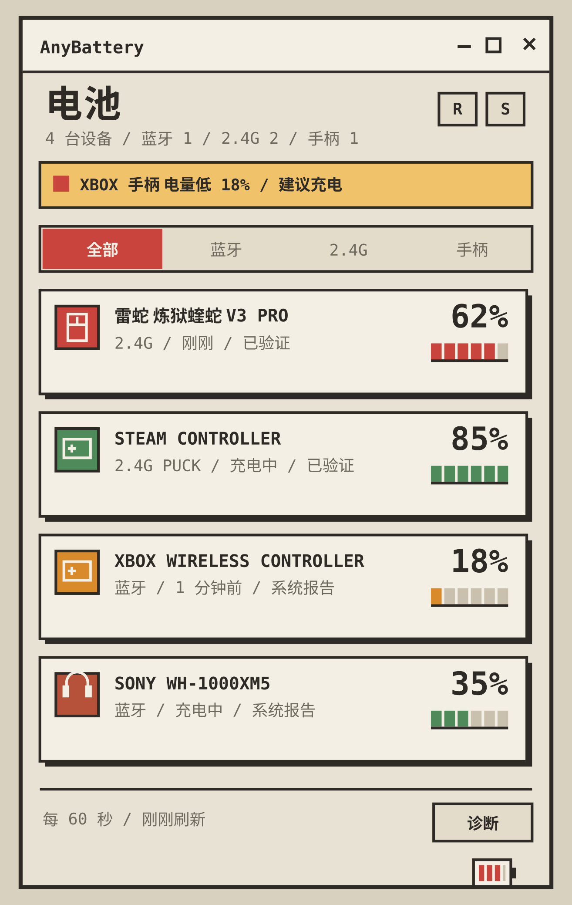

# AnyBattery

Windows 10/11 的 2.4G / 蓝牙设备电量托盘工具。Rust 编写，单 exe，只读，不装驱动，不需要管理员权限。



## 下载

前往 [Releases](../../releases) 下载最新 `AnyBattery-*-win64.zip`，解压后直接运行 `AnyBattery.exe`。

- 单文件，无安装器
- 静态 CRT，不依赖 WebView2 / VC++ Redistributable
- 内置 Fusion Pixel 12px 中文像素字体
- 应用自绘像素标题栏与窗口按钮：最小化 / 最大化/还原 / 关闭到托盘
- 像素电池应用图标：exe、窗口、标题栏与托盘默认图标同源
- 未签名，SmartScreen 可能提示“未知发布者”

## 设备支持矩阵

> 最后更新：2026-10-27。本表以当前工作树代码为准，不把上游项目的 “Verified” 直接当成 AnyBattery 的本机验证。设备能否被 Windows 枚举，不等于能读取电量；未匹配到电量协议的设备默认隐藏，打开“显示无电池设备”后才会以“未找到电量协议”列出。逐项来源、fixtures 和未决项见 [`docs/protocol-research/`](docs/protocol-research/)。

状态含义：

| 标记 | 含义 |
|---|---|
| ✅ 本机验证 | 有本机真实扫描或官方软件校准证据；会注明证据文件或读数。 |
| 🟡 社区协议 | 有代码路由和严格 parser/fixtures，但未在本机对应型号上验证；标“脚本传输测试”表示生产 session 路径已有脚本驱动测试、仍无对应真机；不代表所有同 VID:PID 设备都兼容。 |
| 🧪 实验/运行时修复 | 有路由，但存在会话、传输、接口、硬件门或 parser/证据缺口；不得当作稳定可用。 |
| ⚪ 系统/标准 | 依赖 Windows PnP、标准 HID 描述符或 WGI 实际暴露；设备不暴露就没有电量。 |
| ❌ 未支持/已排除 | 已知的重要排除项，不可能穷举世界上所有设备。 |

补充约定：

- “充电未知”与“未充电”不同：只有协议明确返回 0/放电时才写“未充电”，没有字节或状态冲突时写“未知”。
- 同一 VID:PID 可能被不同厂商/固件复用；本表只承诺代码中列出的 PID、接口、usage 和报文形状，不承诺“同 VID:PID 的所有设备”。
- 矩阵中的 🟡 不是“稳定支持”，🧪 不是“已经修好”；发布说明必须沿用这里的等级。
- 本表状态是证据等级，不直接等同 UI 的“已验证 / 社区协议 / 系统报告”标签；例如 M618Air 的通用 1D57 路由在代码中仍保留 Community，但本行已有官方校准和实扫证据。

### Windows 系统与标准接口

| 设备 / 接口 | VID:PID 或条件 | 协议 / 报文 | 电量 / 充电 | 状态 | 限制 / 证据 |
|---|---|---|---|---|---|
| Windows 蓝牙 PnP（经典/BLE） | BTHENUM / BTHLE 任意设备 | `DEVPKEY_BLUETOOTH_BATTERY` PnP 属性 | 1–100% / 未知 | ⚪ 系统/标准 | 纯只读系统属性；设备未暴露或值为 0 时不显示；不做主动 GATT。 |
| 蓝牙 HFP / 服务节点合并 | 同一 ContainerId | BTHENUM 服务节点电量并入根卡 | 继承服务节点电量 / 未知 | ⚪ 系统/标准 | 零、空、全零 ContainerId 不合并；多个经典根只允许唯一经典根接收 HFP 数据；OPPO 已验证，其他型号未逐台验证。 |
| OPPO Enco X3 | BTHENUM `DEV_407218C8A7BC`（系统节点，无公开 VID:PID） | Windows PnP + HFP ContainerId 合并 | 实测 90% / 100%；充电未知 | ✅ 本机验证 | `.pi/diag-hfp-merge.txt` 显示 100%，`.pi/diag-final-integration.txt` 显示 90%；HFP 单卡；当前 208 项 Windows 测试通过。 |
| Zero 1 | BTHLE `DEV_CC3D601F1B0C` | Windows BLE PnP | 实测 46%；充电未知 | ✅ 本机验证 | `.pi/diag-final-integration.txt`；GATT 服务节点归并到根卡；仍是 PnP 属性，不是主动 GATT。 |
| 标准 HID Battery System | usage `0x0085:0x0064`、`0x0085:0x0065`，充电/放电 `0x44/0x45` | Feature/Input value | 百分比 / 充电、放电标志 | ⚪ 系统/标准 | 不再接受 `0x66` 或 `0x0001` 猜百分比；依赖设备描述符和 logical min/max。 |
| 标准 HID Battery Strength / Digitizer | `0x0006:0x0020`、`0x000D:0x003B` | Feature/Input value | 百分比 / 无充电位则未知 | ⚪ 系统/标准 | 依赖描述符；没有标准充电 usage 时保持未知。 |
| Xbox / GameSir / FlyDigi 等游戏手柄 | 任意 `RawGameController` | `Windows.Gaming.Input` 电池报告 | mWh 比例 / 系统状态 | ⚪ 系统/标准 | 依赖系统实际提供 `TryGetBatteryReport`；Transport 固定 USB 是展示限制；可能与 HID 卡重复。 |
| BLE GATT Battery Service 主动读取 | 任意 BLE `0x180F/0x2A19` | 未实现 | — | ❌ 未支持/已排除 | 主轮询不做主动连接；需要独立异步 Watcher，避免音频/射频冲突。 |

### 手柄

| 型号 / 型号组 | VID:PID / 接口 | 协议 / 报文 | 电量 / 充电 | 状态 | 限制 / 证据 |
|---|---|---|---|---|---|
| Steam Controller 2025（USB / 蓝牙） | `28DE:1302` / `28DE:1303` | HID input `0x43`，约 5 秒监听窗口 | 百分比 / `0x43` 状态位 | 🟡 社区协议 | 代码内 Verified 来自上游；本机未验证。 |
| Steam Controller Puck（Proteus / Nereid） | `28DE:1304` / `28DE:1305`；interface 2–5 | 槽位连接报告 + Feature 关闭 lizard mode，再读 HID input `0x43` | 百分比 / 状态位 | ✅ 本机验证 | 只匹配四个手柄槽位，先等连接或状态报告，避免向空槽写 Feature；本机 `1304` 槽位 1 实测 100%、充电中。 |
| Flydigi APEX 6 / Vader 5 Pro | `37D7:2502` / `37D7:2401`，`FFA0`，33B 或 65B | GPA6 `5A A5` 信息查询 `0x01` | 百分比 / 充电位 | 🟡 社区协议（脚本传输测试） | 校验命令、长度和校验和；本机未验证。 |
| Sony DualShock 4 | `054C:05C4` / `054C:09CC` / `054C:05C5` / `054C:0BA0` | input `0x01` / `0x11`，USB byte30、蓝牙 byte32 | 百分比 / 线缆位 | 🟡 社区协议 | `11` 为满电，`14/15` 保持未知；仅监听，不触发厂商 feature。 |
| Sony DualSense | `054C:0CE6` | input `0x01` / `0x31`，USB byte53、蓝牙 byte54 | 百分比 / 高半字节状态 | 🟡 社区协议 | 低半字节 `0x0C` 表示不报告；高半字节 2 为充满。 |
| Sony DualSense Edge | `054C:0DF2` | 同 DualSense | 百分比 / 状态 | 🟡 社区协议 | 本机未验证。 |
| Nintendo Joy-Con (L)/(R) / Switch Pro | `057E:2006` / `057E:2007` / `057E:2009` | 蓝牙 input `0x21` / `0x30` / `0x31` | 8 档换算百分比 / 充电位 | 🟡 社区协议 | 只处理蓝牙路径；USB 不读；未实现完整模式子命令回退。 |
| 8BitDo SF30 Pro | `2DC8:6000` / `2DC8:6100` | input `0x01`（蓝牙）/ `0x04`（USB），byte14 | 百分比 / bit7 充电 | 🟡 社区协议 | 上游格式；本机未验证。 |
| 8BitDo SN30 Pro | `2DC8:6001` / `2DC8:6101` | 同上 | 百分比 / bit7 充电 | 🟡 社区协议 | 上游格式；本机未验证。 |
| 8BitDo Pro 2 | `2DC8:6003` / `2DC8:6006` | 同上 | 百分比 / bit7 充电 | 🟡 社区协议 | 上游格式；本机未验证。 |
| 8BitDo Pro 3 | `2DC8:6009` | input `0x04`，byte14 | 百分比 / bit7 充电 | 🟡 社区协议 | 代码内 Verified 来自上游；本机未验证。 |
| 8BitDo Ultimate 2 Wireless | `2DC8:6012` | 蓝牙 `0x01` / USB `0x04`，byte14 | 百分比 / bit7 充电 | 🟡 社区协议 | 型号表新增项；本机未验证。 |

### Razer（雷蛇）

> 口径（以当前 `razer_name` / `razer_uses_special_protocol` 为准）：
> - `razer_name`：101 个 PID / 58 个唯一型号名。
> - 90B 通用：98 个 PID / 56 个唯一型号名（`053A`、`0555`、`0556` 在 `razer_uses_special_protocol` 中改走 PA）。
> - PA：3 个 PID / 2 个型号（`053A`、`0555`、`0556`）。
> - `0528`：1 个 PID / 1 个型号；`0557`：1 个 PID（仅排除）。
> - 总计：103 个 PID / 60 个唯一型号名，另有 1 个无 PID 的 90B 产品名兜底行；Razer 矩阵共 61 行。

Razer 不是全系支持。下列型号必须同时命中 PID、vendor collection、报文长度/形状才会读取；未知型号、朋友设备等没有型号证据时不承诺。

#### 90B 通用 Feature（class `0x07`，cmd `0x80` 读电量、`0x84` 读充电）

代码读取 caps 的 90 字节及以上 FeatureReportByteLength（只有 91 字节有前置 report ID `0`，解析时去掉），雷蛇使用同步零权限 HID 句柄完成 SetFeature → GetFeature；TID 依次尝试表内首选、`0x1F`、`0x3F`、`0xFF`（去重）。每次查询有界等待 busy 或匹配回复；若 Synapse/Chroma 的其他命令回复占用队列，每收到 4 个外回报文重发一次，最多发送 3 次、读取 12 次，不会把其他命令的 `status=0x02` 误当电量。诊断页记录 CreateFile/SetFeature/GetFeature 的 Win32 错误、回复 status/tid/class/cmd/raw 和外回占用原因。电量按 `round(raw * 100 / 255)` 后 clamp 到 `1..=100`，raw=0 视为无效；充电查询 `0x84` 返回 `1` 为充电，查询失败保持未知。下表同一行的多个 PID 是代码中同型号的公开 PID 合并，未逐 PID 验证连接模式。

| 型号 | VID:PID | 首选 TID | 电量 / 充电 | 状态 | 限制 / 证据 |
|---|---|---|---|---|---|
| Razer DeathStalker V2 Pro | `1532:0290` / `1532:0292` | `0x9F` / `0x1F` | 百分比 / 可选 | 🟡 社区协议 | 90B 代码表；本机未验证。 |
| Razer DeathStalker V2 Pro TKL | `1532:0296` / `1532:0298` | `0x9F` / `0x1F` | 百分比 / 可选 | 🟡 社区协议 | `0296` 代码内 Verified 来自上游，不是本机验证；`0298` Community。 |
| Razer BlackWidow V3 Mini HyperSpeed | `1532:0271` / `1532:0258` | `0x9F` / `0x1F` | 百分比 / 可选 | 🟡 社区协议 | 90B 代码表；本机未验证。 |
| Razer BlackWidow V4 Mini HyperSpeed | `1532:02BA` / `1532:02B9` | `0x9F` / `0x1F` | 百分比 / 可选 | 🟡 社区协议 | 90B 代码表；本机未验证。 |
| Razer BlackWidow V4 Tenkeyless HyperSpeed | `1532:02D5` / `1532:02D7` | `0x9F` / `0x1F` | 百分比 / 可选 | 🟡 社区协议 | 90B 代码表；本机未验证。 |
| Razer BlackWidow V3 Pro | `1532:025A` / `1532:025C` | `0x3F` / `0x9F` | 百分比 / 可选 | 🟡 社区协议 | 90B 代码表；本机未验证。 |
| Razer Viper V4 Pro | `1532:00E5` / `1532:00E6` | `0x1F` | 百分比 / 可选 | 🟡 社区协议 | 90B 代码表；本机未验证。 |
| Razer Viper V3 Pro | `1532:00C0` / `1532:00C1` / `1532:00C2` / `1532:00C3` | `0x1F` | 百分比 / 可选 | 🟡 社区协议 | 90B 代码表；本机未验证。 |
| Razer Viper V3 Pro SE | `1532:00DE` / `1532:00DF` | `0x1F` | 百分比 / 可选 | 🟡 社区协议 | 90B 代码表；本机未验证。 |
| Razer Viper V3 HyperSpeed | `1532:00AC` / `1532:00AD` | `0x1F` | 百分比 / 可选 | 🟡 社区协议 | 90B 代码表；本机未验证。 |
| Razer Viper V2 Pro | `1532:00A5` / `1532:00A6`（OpenRazer）及 `1532:00B4` / `1532:00B5`（FerrisPulse 修订/别名） | `0x1F` | 百分比 / 可选 | ✅ 本机验证 | 以产品字符串区分 Viper/Cobra/Naga；零 desired-access 同步句柄已打开 `00A6` 的 MI_00、feature 91 通道；用户校准 52%，最终复扫 51%、未充电，TID `0x1F`。 |
| Razer Viper Mini Signature Edition | `1532:00A7` / `1532:00A8` | `0x1F` | 百分比 / 可选 | 🟡 社区协议 | 90B 代码表；本机未验证。 |
| Razer Viper Ultimate | `1532:0084` / `1532:0088` | `0x1F` | 百分比 / 可选 | 🟡 社区协议 | 90B 代码表；本机未验证。 |
| Razer Viper Mini | `1532:0078` | `0x1F` | 百分比 / 可选 | 🟡 社区协议 | 90B 代码表；本机未验证。 |
| Razer Viper 8KHz | `1532:0071` | `0x1F` | 百分比 / 可选 | 🟡 社区协议 | 90B 代码表；本机未验证。 |
| Razer Viper | `1532:0070` | `0x1F` | 百分比 / 可选 | 🟡 社区协议 | 90B 代码表；本机未验证。 |
| Razer HyperPolling Wireless Dongle | `1532:00B9` | `0x1F` | 百分比 / 可选 | 🟡 社区协议 | 是接收器/轮询器，不代表独立设备；本机未验证。 |
| Razer DeathAdder V4 Pro | `1532:00BE` / `1532:00BF` | `0x1F` | 百分比 / 可选 | 🟡 社区协议 | `00BF` 代码内 Verified 来自上游，不是本机验证；`00BE` Community。 |
| Razer DeathAdder V3 Pro | `1532:00B6` / `1532:00B7` | `0x1F` | 百分比 / 可选 | 🟡 社区协议 | 90B 代码表；本机未验证。 |
| Razer DeathAdder V3 HyperSpeed | `1532:00B2` / `1532:00B3` | `0x1F` | 百分比 / 可选 | 🟡 社区协议 | 90B 代码表；本机未验证。 |
| Razer DeathAdder V3 | `1532:00B0` | `0x1F` | 百分比 / 可选 | 🟡 社区协议 | 90B 代码表；本机未验证。 |
| Razer DeathAdder V2 Pro | `1532:00A2` / `1532:00A3` | `0x1F` | 百分比 / 可选 | 🟡 社区协议 | 90B 代码表；本机未验证。 |
| Razer DeathAdder V2 X HyperSpeed | `1532:009C` | `0x1F` | 百分比 / 可选 | 🟡 社区协议 | 90B 代码表；本机未验证。 |
| Razer DeathAdder V2 | `1532:008A` | `0x1F` | 百分比 / 可选 | 🟡 社区协议 | 90B 代码表；本机未验证。 |
| Razer DeathAdder V2 Mini | `1532:007C` / `1532:007D` | `0x1F` | 百分比 / 可选 | 🟡 社区协议 | 90B 代码表；本机未验证。 |
| Razer DeathAdder Elite | `1532:005C` | `0x1F` | 百分比 / 可选 | 🟡 社区协议 | 90B 代码表；本机未验证。 |
| Razer Basilisk V3 Pro 35K | `1532:00CC` / `1532:00CD` | `0x1F` | 百分比 / 可选 | 🟡 社区协议 | 90B 代码表；本机未验证。 |
| Razer Basilisk V3 Pro 35K (Phantom Green) | `1532:00D6` / `1532:00D7` | `0x1F` | 百分比 / 可选 | 🟡 社区协议 | 90B 代码表；本机未验证。 |
| Razer Basilisk V3 35K | `1532:00C4` / `1532:00C5` | `0x1F` | 百分比 / 可选 | 🟡 社区协议 | 90B 代码表；本机未验证。 |
| Razer Basilisk V3 Pro | `1532:009A` / `1532:009B` / `1532:00AA` / `1532:00AB` | `0x1F` | 百分比 / 可选 | 🟡 社区协议 | 90B 代码表；本机未验证。 |
| Razer Basilisk V3 | `1532:00B8` | `0x1F` | 百分比 / 可选 | 🟡 社区协议 | 90B 代码表；本机未验证。 |
| Razer Basilisk X HyperSpeed | `1532:0085` / `1532:0086` | `0x1F` | 百分比 / 可选 | 🟡 社区协议 | 90B 代码表；本机未验证。 |
| Razer Basilisk Ultimate | `1532:007A` / `1532:007B` | `0x1F` | 百分比 / 可选 | 🟡 社区协议 | 90B 代码表；本机未验证。 |
| Razer Basilisk | `1532:0064` | `0x1F` | 百分比 / 可选 | 🟡 社区协议 | 90B 代码表；本机未验证。 |
| Razer Cobra Pro | `1532:00AF`（有线）/ `1532:00B0`（无线，按 OpenRazer） | `0x1F` | 百分比 / 可选 | 🟡 社区协议 | `00A5`/`00A6` 不再单独作为 Cobra 的唯一依据；若产品名为 Cobra 则保留该型号；本机未验证。 |
| Razer Cobra | `1532:00A4` | `0x1F` | 百分比 / 可选 | 🟡 社区协议 | 90B 代码表；本机未验证。 |
| Razer Naga V2 Pro | `1532:008F` / `1532:0090` | `0x1F` | 百分比 / 可选 | 🟡 社区协议 | 90B 代码表；本机未验证。 |
| Razer Naga V2 HyperSpeed | `1532:0095` | `0x1F` | 百分比 / 可选 | 🟡 社区协议 | 90B 代码表；本机未验证。 |
| Razer Naga Pro | `1532:0091` / `1532:0092` | `0x1F` | 百分比 / 可选 | 🟡 社区协议 | 90B 代码表；本机未验证。 |
| Razer Naga Left-Handed Edition | `1532:0080` | `0x1F` | 百分比 / 可选 | 🟡 社区协议 | 90B 代码表；本机未验证。 |
| Razer Naga Trinity | `1532:0067` | `0x1F` | 百分比 / 可选 | 🟡 社区协议 | 90B 代码表；本机未验证。 |
| Razer Orochi V2 | `1532:0099` / `1532:0094` | `0x1F` | 百分比 / 可选 | 🟡 社区协议 | 90B 代码表；本机未验证。 |
| Razer Naga Epic | `1532:001F` | `0xFF` | 百分比 / 可选 | 🟡 社区协议 | 90B 代码表；本机未验证。 |
| Razer Mamba (2012) | `1532:0024` / `1532:0025` | `0xFF` | 百分比 / 可选 | 🟡 社区协议 | 90B 代码表；本机未验证。 |
| Razer Ouroboros | `1532:0032` | `0xFF` | 百分比 / 可选 | 🟡 社区协议 | 90B 代码表；本机未验证。 |
| Razer Naga Epic Chroma | `1532:003E` / `1532:003F` | `0xFF` | 百分比 / 可选 | 🟡 社区协议 | 90B 代码表；本机未验证。 |
| Razer Mamba | `1532:0044` / `1532:0045` | `0xFF` | 百分比 / 可选 | 🟡 社区协议 | 90B 代码表；本机未验证。 |
| Razer Lancehead | `1532:0059` / `1532:005A` | `0x3F` | 百分比 / 可选 | 🟡 社区协议 | 90B 代码表；本机未验证。 |
| Razer Atheris | `1532:0062` | `0x1F` | 百分比 / 可选 | 🟡 社区协议 | 90B 代码表；本机未验证。 |
| Razer Lancehead Wireless | `1532:006F` | `0x1F` | 百分比 / 可选 | 🟡 社区协议 | 90B 代码表；本机未验证。 |
| Razer Mamba Wireless | `1532:0072` / `1532:0073` | `0x3F` | 百分比 / 可选 | 🟡 社区协议 | 90B 代码表；本机未验证。 |
| Razer Pro Click | `1532:0077` | `0x1F` | 百分比 / 可选 | 🟡 社区协议 | 90B 代码表；本机未验证。 |
| Razer Viper Mini SE | `1532:009E` / `1532:009F` | `0x1F` | 百分比 / 可选 | 🟡 社区协议 | 90B 代码表；本机未验证。 |
| Razer Pro Click V2 Vertical Edition | `1532:00C7` / `1532:00C8` | `0x1F` | 百分比 / 可选 | 🟡 社区协议 | 90B 代码表；本机未验证。 |
| Razer Pro Click V2 | `1532:00D0` / `1532:00D1` | `0x1F` | 百分比 / 可选 | 🟡 社区协议 | 90B 代码表；本机未验证。 |
| Razer Basilisk Mobile | `1532:00D3` / `1532:00D4` | `0x1F` | 百分比 / 可选 | 🟡 社区协议 | 90B 代码表；本机未验证。 |

> 本机验证：Razer Viper V2 Pro `00A6` 已找到 MI_00、feature 91 的 90B 通道。HID 枚举使用零 desired-access 同步句柄，不是要求管理员权限；FerrisPulse 同时运行会争抢 HID 回报，测试前需退出。

#### 专用 64 字节 / PA 路径与排除

| 型号 | VID:PID / 接口 | 协议 / 报文 | 电量 / 充电 | 状态 | 限制 / 证据 |
|---|---|---|---|---|---|
| Razer BlackShark V2 Pro (2020) | `1532:0528`；`FF00:0001`，feature 64B | 64B `0xFF`；请求 `FF 0A 00 FD 04 12 F1 02 05`；state 在 11，mV 在 12–13，level 在 14 | 有 / state `09` 充电，`01/02/03/06` 未充电，其他未知；充电中电量仅粗略参考 | 🟡 社区协议 | 仅 fixture；本机未验证；通用 90B 和 PA 路径明确拒绝 0528；上游提示充电中自报值可能跳变。 |
| Razer BlackShark V2 Pro (2023) | `1532:0555` / `1532:0556`；64B vendor collection（`FF00` / `FF14`） | PA `P A` / `P I`，0x21 电量、0x2A 充电 | 有 / 有 | 🟡 社区协议（脚本传输测试） | 先 drain；每次尝试先 remote-on，BlackShark 3 次重试；同一句柄读电量与充电，最后 remote-off 恢复会话；`0555`/`0556` 均为 Community，生产 session 有脚本传输测试，无对应真机。 |
| Razer Barracuda Pro (2.4 GHz) | `1532:053A`；64B vendor collection（`FF00`） | PA，report `0x01`，0x21/0x2A | 有 / 有 | 🟡 社区协议（脚本传输测试） | 先 drain；每次尝试先 remote-on，Barracuda 4 次重试；同一句柄读电量与充电，最后 remote-off 恢复会话；生产 session 有脚本传输测试，无对应真机。 |
| Razer Barracuda X (2022) | `1532:0552`；`FF00:0000`，64B Input/Output | RACE 控制命令 `0xE3/0xE6/0xE0` 验证在线、传输和路由，再以 PA `0x21/0x2A` 读取 | 有 / 有 | ✅ 本机验证 | 独立 64B 通道，不进入 90B 鼠标路径；最终复扫实测 53%、未充电。 |
| Razer 未列入 PID 的无线设备 | 产品名含 `wireless`、`hyperspeed`、`receiver`、`dongle`、`blackshark`、`barracuda` | 90B 兜底，置信度 Unverified | 成功才有 | 🧪 实验/运行时修复 | 朋友设备型号未知，不承诺；只有产品名命中才尝试，失败即隐藏。 |
| Razer BlackShark V2 X USB（有线） | `1532:0557` | 不进入 90B/PA | — | ❌ 未支持/已排除 | 公开 USB ID 是有线音频设备，不是 BlackShark V2 Pro 2023；代码已显式跳过。 |

### Logitech（罗技）

| 设备 / 型号组 | VID:PID / 接口 | 协议 / 报文 | 电量 / 充电 | 状态 | 限制 / 证据 |
|---|---|---|---|---|---|
| Logitech HID++ 2.0 设备 | `046D` 任意 HID++ vendor collection；直连 slot `0xFF` 或接收器槽位 | software ID `0x08`、ping token `0x5A`，长帧 → 短帧 → legacy ping；features `0x1000/0x1001/0x1004/0x1F20`，short 7 / long 20 | 百分比或电压曲线 / `0x1000`/`0x1004`：status 0=未充、1–3=充、4–7=未知；`0x1001`：bit7=0 未充电，bit7=1 时低三位 0/1=充、2=未充、3–7=未知 | 🟡 社区协议 | 四种 HID++ 2.0 feature 都失败后回退 HID++ 1.0；严格校验 ping token 和充电状态；本机未验证。 |
| Logitech Unifying / Bolt / Lightspeed 接收器 | 已知接收器表，新增 `046D:C542`（Bolt）、`046D:C54F`，并覆盖 `046D:C500..C5FF` | Unifying / Bolt 扫槽 1–6，其他接收器扫槽 1–2；同一句柄长短帧协商 | 同 HID++ 2.0 / 1.0 | 🟡 社区协议 | 已知 PID 名称表只作 fallback，不覆盖设备自报名称；空槽和离线设备可能等待超时；本机未验证。 |
| Logitech HID++ 1.0 / 老设备 | `046D`，HID++ 2.0 feature 查询均失败 | register `0x0D` 电量查询，legacy ping 回退 | 百分比 / 未知 | 🟡 社区协议 | 只接受有效百分比 payload，不使用缓存或默认 100%；本机未验证。 |
| Logitech G PRO X Wireless 耳机 | `046D:0ABA`，`FF43` 通道 | software ID `0x0B`，ADC flags 与专用 12 点电压曲线 | 电压换算百分比 / ADC 充电状态 | 🟡 社区协议 | 独立通道，不套用通用 ADC 曲线；严格校验 flags 与 mV 范围；本机未验证。 |

### CompX / VAXEE / Endgame / Nordic / ASUS / NZXT

| 型号 / 型号组 | VID:PID / 接口 | 协议 / 报文 | 电量 / 充电 | 状态 | 限制 / 证据 |
|---|---|---|---|---|---|
| Pulsar X2 V2 Mini | `3554:F508`（2.4G）/ `3554:F507`（USB） | CompX 17B `08 04`，checksum `0x55-sum`；FF05 时 64B 兜底 | 17B：level `frame[6]`、充电 `frame[7]`；64B：level `reply[7]`、充电未知 | 🟡 社区协议 | 代码内 Verified 来自上游；本机未验证。 |
| ATK VXE R1 SE+ | `3554:F58F`（USB）/ `373B:1085`（2.4G） | 同上 | 同上 | 🟡 社区协议 | 代码内 Verified 来自上游；本机未验证。 |
| VXE R1 Pro Max | `3554:F58A`（2.4G）/ `3554:F58C`（USB） | 同上 | 同上 | 🟡 社区协议 | 代码内 Verified 来自上游；本机未验证。 |
| Pulsar X2 CrazyLight Mini | `3710:5406`（2.4G）/ `3710:3414`（USB） | 同上 | 同上 | 🟡 社区协议 | 代码内 Verified 来自上游；本机未验证。 |
| Hitscan Hyperlight | `3770:0200`（2.4G）/ `3770:0100`（USB） | 同上 | 同上 | 🟡 社区协议 | 代码内 Community；本机未验证。 |
| VGN / VXE Dragonfly 蜻蜓系列 | `3554:FB3E/FC03/FC04/FC05/FB24/FB25/FB26/FB27`，`FF02:0002`，Input/Output ≥17B | 同一句柄依次执行 cmd 1 握手、cmd 2 PC 状态、cmd 3 在线检查、cmd 4 电量；checksum `0x55-sum` | level `frame[6]` / `frame[7]==1` 充电 | 🟡 社区协议（脚本传输测试） | 覆盖 F1/F1 Pro/F1 Pro Max/F1 MOBA、F2 系列、R1 SE/Pro/Pro Max；cmd 3 离线时不查询电量；严格校验命令与校验和；本机未验证。 |
| VAXEE / ZYGEN | `3057` 任意，usage page `FF05`（任意 usage），feature 64B | feature `0E A5`；page `0x0B` 电量、page `0x10` 充电 | 电量 = raw `0..20` × 5；充电 0/1 | 🟡 社区协议 | 仅协议事实和 fixtures；本机未验证；没有按 PID 收窄。 |
| Endgame Gear | `3367` 任意，usage `FF01`，feature 64B | feature `A1 B4`，level 在 16，mV 在 17–18 | 有电量 / 充电未知 | 🟡 社区协议 | 证据较弱；本机未验证。 |
| Nordic nRF | `1915` 任意，usage `FFA0`，feature 32B | feature `05 15`，level 在 9 | 有电量 / 充电未知 | 🟡 社区协议 | 证据较弱；本机未验证。 |
| ASUS ROG 无线鼠标 | `0B05` vendor collection，65B；步进 PID：`0B05:18E5`、`0B05:18E3`、`0B05:1960`、`0B05:195E`、`0B05:1A59`、`0B05:1A57`、`0B05:1908`、`0B05:1906`、`0B05:1949`、`0B05:1947` | `0x12 0x07` | level `offset+4`；步进 PID ×25%，其他 ≤100 直接；充电 `offset+9` | 🟡 社区协议 | 未按 PID/接口收窄；充电字节缺失时当前按未充电，是已知限制；本机未验证。 |
| NZXT Lift Elite / 同族 | `1E71:2101` / `1E71:2129`，usage `FFCA:0001` | `4E 02 81 00 B0`，level LE 17–18，charge bit22 | 有 / 有 | 🟡 社区协议 | 上游协议；本机未验证。 |

### OEM 鼠标：PixArt / MCHOSE / Delux

> OEM 7 项代码审查与修复已确认，但没有因此升级 Verified：PixArt/MCHOSE 保持 🟡 社区协议，Delux M800 Pro 继续因 Windows MI_01 硬件门保持 🧪。MCHOSE 已按 caps 长度填充后截断（caps65）并在同一句柄处理 21/65 通道；A5 Pro Max 的多个 `0xFFFF` collection 按 container 分组、usage 0 优先、usage 1 仅作同容器 fallback。

| 型号 | VID:PID / 接口 | 协议 / 报文 | 电量 / 充电 | 状态 | 限制 / 证据 |
|---|---|---|---|---|---|
| WLmouse Beast X Max (8K) | `36A7:A880`，`FFFF:0000`，feature 65B | PixArt/JM `00 ... 83`，回复 `A1/A2`，level raw[8]、charge raw[7] | 有 / 有 | 🟡 社区协议 | 上游声明实机，AnyBattery 未本机验证；A0/A3 帧拒绝。 |
| WLmouse Beast X | `36A7:A887` | 同上 | 有 / 有 | 🟡 社区协议 | 接收器表，未确认；本机未验证。 |
| WLmouse Beast X Mini Pro | `36A7:A868` | 同上 | 有 / 有 | 🟡 社区协议 | 接收器表，未确认；本机未验证。 |
| LAMZU Maya X | `373E:001E`（8K）/ `373E:001C`（USB）；interface 2 | 同上 | 有 / 有 | 🟡 社区协议 | 上游声明实机，AnyBattery 未本机验证；只认 interface 2 的 `FFFF:0000`。 |
| Attack Shark R5 Ultra | `373E:0046`（USB）/ `373E:0047`（2.4G）；产品名含 `attack shark` | 同上 | 有 / 有 | 🟡 社区协议 | bridge profile，不是硬件实测；本机未验证。 |
| MCHOSE A5 Pro Max | `2023:F013`（1K）/ `2023:F015`（4K）/ `2023:F019`（USB）；产品名含 `mchose` | 同上；多 `0xFFFF` collection 按 container 分组，usage 0 优先，usage 1 仅同容器 fallback | 有 / 有 | 🟡 社区协议 | 分组修复已确认；issue 报告仅 1K 硬件确认，其余未试；本机未验证；不升 Verified。 |
| MCHOSE M7 Ultra | `5253:1020`（2.4G）/ `5253:0031`（USB），`FF01:0001` | 反码 Feature，report `0x11` 21B / `0x12` 65B；caps 长度填充后截断，同句柄短/长通道；每次 GET 前重发 | level payload[9]、charge payload[10] | 🟡 社区协议 | 上游固件实测，AnyBattery 未本机验证；只按 PID 白名单；完整 handle 级 `SetFailed`/`GetFailed` 路由仍缺 fake-HID 端到端测试，需真机。 |
| MCHOSE A5 V2 Ultra | `3837:100C`（2.4G）/ `3837:1101`（USB） | 同上 | 有 / 有 | 🟡 社区协议 | FerrisPulse 常量；本机未验证。 |
| MCHOSE A7 V2 Ultra | `3837:100B`（2.4G） | 同上 | 有 / 有 | 🟡 社区协议 | 上游 issue；本机未验证。 |
| Angry Miao AM Infinity .97（怒喵） | `0E8D:0703/0880`、`35A1:0035`，Feature ≥62B | 62B `0x14 ... RACE` Feature，命令 `0x30CF`；`0703` route `0x80`，其他为 0；GetFeature 最多轮询 8 次 | 百分比 / 充电状态 | 🟡 社区协议（脚本传输测试） | 接受 62B 与带前导 0 的 63B 回复，严格校验 RACE、响应类型和小端命令；本机未验证。 |
| Delux M800 Pro | `248A:5B2F`（2.4G）/ `248A:5B2E`（有线）；MI_01，feature 33B | Feature `0C 01 20 seq`，level raw[18]、charge raw[19] | 有 / 有 | 🧪 实验/运行时修复 | Windows 必须枚举出 MI_01 且 feature_len=33 才发送；无该 HID collection 时停止，不猜 raw USB；8 次有界重试；本机未验证。 |

### 键盘与键鼠接收器

| 型号 / 型号组 | VID:PID / 接口 | 协议 / 报文 | 电量 / 充电 | 状态 | 限制 / 证据 |
|---|---|---|---|---|---|
| AULA / 3554:FA09 2.4G 键盘接收器 | `3554:FA09`，`FF02:0002`，in/out 20B | 代码发送 `13 05 01` 身份查询，但 parser 只接受 `13 0A` 电量应答 | 成功才有 / 充电未知 | 🧪 实验/运行时修复 | 本机只枚举到接收器；最终扫描 5 个 collection 仅一张 unknown 卡、无重复；`0x05` 返回型号应答并拒绝，`0x4A` 多次无响应；不猜电量。 |
| Keychron M5 / Ultra-Link 8K | `3434:D028`（接收器）/ `3434:D048`（有线），interface 4，64B Feature + Input | `B3 06` → `B4 06`，level byte20 | 有电量 / 充电未知 | 🟡 社区协议（脚本传输测试） | 仅 interface 4；同一句柄 Feature SET + `B4` Input；先 drain，最多 3 次、间隔 100ms、每次 500ms；生产 session 有脚本传输测试，无对应真机；设备类型仍标鼠标。 |
| Lofree Hyzen | `388D:0025`，usage `FF1C:0092` | `04 00 00 01` 启动 → `1A` 查询 → `02` 结束；level reply[8] | 有电量 / 充电未知 | 🟡 社区协议 | 只支持 Hyzen 证据；未先查在线状态，离线返回 0 时可能被当 0%；本机未验证。 |
| NuPhy 已知无线键盘 | `19F5:A011/8F01..8F07`，65B Input/Output | `0x04` 模式查询 + `0x05` 电量读取 | 1–100% / 充电未知 | 🟡 社区协议（脚本传输测试） | 只接受真实当前回复，不使用缓存或默认 100%；本机未验证。 |
| MCHOSE G87 V2 键盘 | `3837:3033`，Input/Output ≥65B | 首选 `00 + 55 05 00 38 38` 性能查询，回复 `AA 05`，level[40]、charge[41]；失败后回退旧固件无线 `13 4A` / 有线 `09 87` | 百分比 / 充电位，旧固件高半字节充电、低半字节充满 | 🟡 社区协议（脚本传输测试） | 同一句柄 drain 后依次查询，无线请求含前 19 字节校验和；只接受当前有效回复；本机未验证。 |
| Rapoo 无线鼠标 | `24AE` vendor collection，19B Input | 被动 `0x07` 遥测，level[8]、charge[7] | 1–100% / 0 未充、2 充电，其余未知 | 🟡 社区协议 | 只监听，不主动写配置；本机未验证。 |
| Valkyrie 键盘 / 鼠标 | `374A/3151/347A`，64B 或 65B Feature | `0xF7` Set + Get，按设备类型拆键鼠卡片 | 1–100% / 充电未知 | 🟡 社区协议（脚本传输测试） | 只有当前真实报文才显示；本机未验证。 |
| Apple Magic Mouse / Keyboard / Trackpad | `05AC` / `004C`，产品名含 `magic`，Feature ≥2B | 同一句柄依次查询 Feature `0x47`、`0xD1`，level[1] | 1–100% / 充电未知 | 🟡 社区协议（脚本传输测试） | 严格限制 Apple VID 与 Magic 产品名；本机未验证。 |

### 耳机与其他外设

| 型号 / 型号组 | VID:PID / 接口 | 协议 / 报文 | 电量 / 充电 | 状态 | 限制 / 证据 |
|---|---|---|---|---|---|
| Sony INZONE Buds（WF-G700N） | `054C:0EC2`，`FF04:0001`，64B Input/Output | report `0x02` 查询，校验序列和 checksum | 左耳、右耳、充电盒百分比 / 各自充电状态 | 🟡 社区协议（脚本传输测试） | 拆成三张卡片；本机未验证。 |
| AirPods / Beats（Apple Continuity） | Apple Company ID `0x004C`，27B `0x07` 广播 | Proximity Pairing 电量半字节与充电位，30 秒过期 | 左耳、右耳、充电盒 10% 步进 / 各自充电状态 | 🟡 社区协议 | 仅绑定当前已连接的 Apple/Beats 音频设备；多候选无法归属时不显示，避免冒认附近设备；本机未验证。 |
| SteelSeries Nova 7（离散档） | `1038:2202`、`1038:2206`、`1038:220A`、`1038:223A`、`1038:227A`、`1038:22A4`，usage `FFC0` | `B0` 回复；level reply[2] ×25 | 有 / reply[3] 01/02 为充电 | 🟡 社区协议 | 上游协议；本机未验证。 |
| SteelSeries Nova 7（百分比） | `1038:22A1`、`1038:227E`、`1038:2258`、`1038:229E`、`1038:22AD`、`1038:22A9`、`1038:22A5`、`1038:22A7`，usage `FFC0` | `B0` 回复；level reply[2] | 有 / reply[3] 01/02 为充电 | 🟡 社区协议 | 上游协议；本机未验证。 |
| SteelSeries Nova 5 | `1038:2232`、`1038:2253`，usage `FFC0` | `B0` 回复；离线 reply[1]=0x02；level reply[3] | 有 / reply[4]=1 为充电 | 🟡 社区协议 | 上游协议；本机未验证。 |
| SteelSeries 通用 AA 鼠标 | `1038` 其他 PID，usage `FFC0` | 64B `AA 01` | level reply[1] / 充电未知 | 🧪 实验/运行时修复 | 代码内是 `Confidence::Unverified`；仅检查 `AA` 头、长度和 ≤100，无严格型号 fixtures；不得视为社区协议或稳定支持。 |
| HyperX Cloud II Wireless / 同协议 | `03F0:0696` / `03F0:018B`，usage `FF90:0303` | 52B `06 FF BB 02`，充电 `06 FF BB 03` | level reply[7] / 有充电查询 | 🟡 社区协议 | 上游协议；本机未验证。 |
| HyperX Cloud III Wireless（飓风 3 无线版） | `03F0:05B7/0C9D`，Output 62B、Input ≥62B | report `0x66`，同一句柄 drain 后依次查询 `0x82` 连接、`0x8A` 充电、`0x89` 电量；接受 `0x0B/0x0C/0x0D` 主动上报，总窗口 240ms | level[4] / 充电 0=未充、1=充电、2=充满并锁定 100% | 🟡 社区协议（脚本传输测试） | 两个状态位同时为 0 时拒绝无效电量；`03F0:06BE` Cloud III S 明确排除；本机未验证。 |
| Corsair Dark Core RGB Pro SE | `1B1C:1B7F`，`FF42:0001` | bragi 65B，property `0x0F` | level raw LE / 充电未知 | 🟡 社区协议（脚本传输测试） | 只问 `0001` 通道；同一句柄先 drain，电量窗口 6 秒、总 deadline 7 秒；第二次相等才确认，不一致拒绝；生产 session 有脚本传输测试，无对应真机。 |
| Corsair Virtuoso SE / XT | `1B1C:0A40` / `1B1C:0A3E` / `1B1C:0A64`，`FF42:0001` | bragi 64B，property `0x0F` 电量、`0x10` 充电 | 有 / 有 | 🟡 社区协议（脚本传输测试） | 同一句柄先 drain；`0A40` 依次 firmware → receiver heartbeat → headset heartbeat；电量窗口 6 秒、总 deadline 7 秒、二次相等确认后再读充电；生产 session 有脚本传输测试，无对应真机。 |

### Beken / 1D57 2.4G

| 型号 / 型号组 | VID:PID / 接口 | 协议 / 报文 | 电量 / 充电 | 状态 | 限制 / 证据 |
|---|---|---|---|---|---|
| DELUX M618Air（model `0x24`） | `1D57:FA60`，MI_02，`000A:0000`，input 5B | 被动 `03 24 40 01 <raw>`；官方 `0x4290b0 → 0x421b90` 档位映射 | raw `1/2/3/4-5/6-7/8..100` → `10/20/40/60/80/100`；state 01 按前版契约记为未充电（官方 handler 未解码充电位） | ✅ 本机验证 | 官方软件 raw6 显示 80%；`.pi/diag-final-integration.txt` 实扫 raw7 显示 80%，charging `Some(false)`，最终集成扫描 2.99 秒、30 秒硬超时内完成，devices=4/bluetooth=2/hid=9；当前 208 项 Windows 测试通过；state `02/03/80` 仍拒绝；名称保持中性。 |
| 其他 1D57:FA60 / Beken 兼容设备 | `1D57:FA60`，MI_02，`000A:0000`，input 5B | 被动 `03 <id> 40 <state> <raw>` | `0x55` 直接；`0x10/0x85` ×10；其他直接；充电未知 | 🟡 社区协议 | 严格校验头、长度、range；不同 device ID 无品牌/型号承诺；`0x24` 只在 M618Air 证据上下文解释。 |

### 未支持 / 已排除

| 项目 | VID:PID 或范围 | 原因 | 状态 |
|---|---|---|---|
| Steam Controller 2015 | `28DE:1142` 等旧接收器 | 未实现旧协议；当前仅 2025/Puck 的 `0x43` | ❌ 未支持/已排除 |
| Jieli / DARKRIM | 厂商私有 2.4G | 未实现；没有稳定的一手只读证据 | ❌ 未支持/已排除 |
| JBL | `0ECB:*` | 未实现 | ❌ 未支持/已排除 |
| MCHOSE V9 Turbo+ 耳机 | `3837:600A` | 是 Input `0x55` 耳机协议，绝不能进入鼠标反码路由 | ❌ 未支持/已排除 |
| HyperX 其他家族（Cloud III S/II Core/Alpha 2 等） | `03F0:*` 非 `0696/018B/05B7/0C9D` | 未实现逐家族报文；Cloud III S `06BE` 不走 Cloud III 通道 | ❌ 未支持/已排除 |
| SteelSeries Rival/Aerox 新协议 | `1038` 非 Nova 型号 | 未实现；通用 AA 只是未验证兜底 | ❌ 未支持/已排除 |
| LAMZU 非 Maya X / Incott / G-Wolves 等 | `373E:0001..0005`、`093A:*`、`33E4:*` 等 | 无本协议证据或未实现，不按同 VID 泛化 | ❌ 未支持/已排除 |

按行统计：✅ 6、🟡 111、🧪 4、⚪ 5、❌ 9，共 135 行。该统计随矩阵行数变化，修改表格时必须同步；完整型号数、PID 数和证据仍以代码与 `docs/protocol-research/` 为准。

与设备协议无关的产品级未实现项：跨扫描/跨启动电量缓存、自定义 JSON 协议导入界面、系统 Toast 通知、代码签名。当前状态卡可以显示休眠、未知、未找到协议等状态，但不会保存并重用上一轮扫描的电量；`Asleep`/`Stale` 只是状态展示，不等同于缓存。未识别设备默认不显示，打开“显示无电池设备”后才会列出并标注“未找到电量协议”。

## 功能

- 托盘常驻，左键面板，右键菜单
- 深色 / 浅色 / 跟随系统，八位堂像素风自绘界面：硬边框、零圆角、方块电量、Fusion Pixel 12px 中文字体
- 应用自绘像素标题栏：左侧电池图标 + AnyBattery，右侧最小化、最大化/还原、关闭到托盘三个像素按钮；关闭隐藏到托盘，退出仍走托盘右键菜单
- 像素电池应用图标：exe、窗口、标题栏与托盘默认图标同源；静态品牌图标固定色，动态托盘按最低电量使用五档色
- 五档电量配色：0–10 红、11–20 橙、21–50 黄/赭黄、51–80 黄绿/橄榄、81–100 绿；卡片电量格与动态托盘一致，充电保留档色；10%/20% 提醒阈值不变
- 电量格、充电状态、上次更新时间、数据来源与“已验证 / 社区协议 / 未验证”标记
- 一个接收器下的多台设备拆成独立卡片（罗技 HID++ 多设备槽）
- 刷新间隔 15 秒 – 30 分钟可调，默认 60 秒
- 低电量横幅与托盘图标变色
- 诊断页：HID 接口、usage、报文来源、复制诊断信息
- 手动 2.4G 被动适配（MVP）：设置 → 手动适配，选择接口、捕获输入报文、输入两个厂商电量样本、两点校准、预览后保存为“用户配置 / 未验证”；只读监听，不发送查询/写入
- 开机自启（HKCU Run，默认关闭）
- 默认只显示有电量的设备；可在设置中打开“显示无电池设备”
- 单实例：第二次启动会唤起已有窗口，不会创建第二个托盘图标或第二份扫描
- 无网络请求、无遥测、不注入进程

## 构建

需要 Rust stable 与 Windows MSVC 目标。Linux 交叉编译可使用 `cargo-xwin` + LLVM：

```bash
rustup target add x86_64-pc-windows-msvc
cargo install cargo-xwin --locked
cargo xwin build -p anybattery-app --target x86_64-pc-windows-msvc --release
```

产物：`target/x86_64-pc-windows-msvc/release/AnyBattery.exe`

Linux 上可运行 core 单测、Windows 单测（GNU + wine）与 app 纯逻辑单测：

```bash
cargo test -p anybattery-core

rustup target add x86_64-pc-windows-gnu
CARGO_TARGET_X86_64_PC_WINDOWS_GNU_RUNNER=wine \
  cargo test -p anybattery-windows --target x86_64-pc-windows-gnu
CARGO_TARGET_X86_64_PC_WINDOWS_GNU_RUNNER=wine \
  cargo test -p anybattery-app --target x86_64-pc-windows-gnu
```

CI 会在 Linux 上跑上述测试，在 Windows 上跑 `cargo test --workspace` 与 MSVC release 构建。wine 只验证纯逻辑与 fixture，不代表 HID/蓝牙真机行为。

## 目录

```text
crates/anybattery-core/     设备模型、设置、去重、JSON 协议解析
crates/anybattery-windows/  SetupAPI/CfgMgr32/HID、蓝牙 PnP、Xbox、厂商适配器
crates/anybattery-app/      egui 面板、托盘、设置、诊断
docs/                       设计图、截图与协议研究
```

## 已知限制

- ✅ 只表示本机扫描或官方校准过的少数项目；🟡 社区协议不等于全系兼容，🧪 运行时修复不等于稳定可用，具体以支持矩阵为准。
- 通用 BLE 设备仍依赖 Windows PnP 电量属性，未主动连接 GATT；Apple Continuity 只额外监听广播并绑定当前已连接设备，不等于通用 GATT 支持。
- 手动适配 MVP 只适用于会主动发出输入报文（input report）的 2.4G 设备；不会主动查询 Feature/Output，也不支持 JSON 导入、充电位、CRC/TLV、多报告状态机。方案与边界见 [docs/manual-2.4g-matching-plan.md](docs/manual-2.4g-matching-plan.md)。
- 灵脉（FerrisPulse）电池协议的静态盘点见 [docs/protocol-research/ferrispulse-battery-inventory.md](docs/protocol-research/ferrispulse-battery-inventory.md)；清单不等于可直接导入的被动 profile。
- 只有 Windows 真机能验证 HID / 蓝牙行为；Linux 侧可用 wine 跑 windows/app 的纯逻辑与 fixture 单测，但不覆盖真实驱动、固件或热插拔。
- Corsair、Keychron、BlackShark / Barracuda Pro 的 Razer PA 已有生产 session/脚本传输测试，但仍无对应真机证据；Barracuda X (2022) 已单独完成本机验证。
- `HidD_GetFeature` / `HidD_SetFeature` 是同步且不可取消的系统调用；个别固件或驱动仍可能让单次读取阻塞。最终集成扫描 2.99 秒只代表当前设备组合，不构成所有设备的硬上界。
- MCHOSE 的 caps65/A5 分组修复仍无对应真机；完整 handle 级 `SetFailed`/`GetFailed` 路由缺少 fake-HID 端到端测试。`1532:0528` 充电中自报电量仅粗略参考。
- 首次扫描会逐个读取 HID 接口，可能需要数秒到十几秒。
- 与 Synapse / G HUB / FerrisPulse 等厂商或第三方软件同时运行时，HID 接口和回报可能争用。
- 目前没有代码签名。

## 许可

MIT OR Apache-2.0。内置 Fusion Pixel 12px 子集，许可见 `crates/anybattery-app/assets/FusionPixel-OFL.txt`。

协议事实参考 HaloBattery（MIT）、SDL3（zlib）、OpenRazer（GPL-2.0，仅协议常量）、HeadsetControl（GPL-3.0，仅协议事实）、FerrisPulse（GPL-3.0，commit `4917a10e238ed3dba2938969752886353c8ff5e9`，仅协议事实）等公开资料；本项目为净室重写，不包含其源代码。
